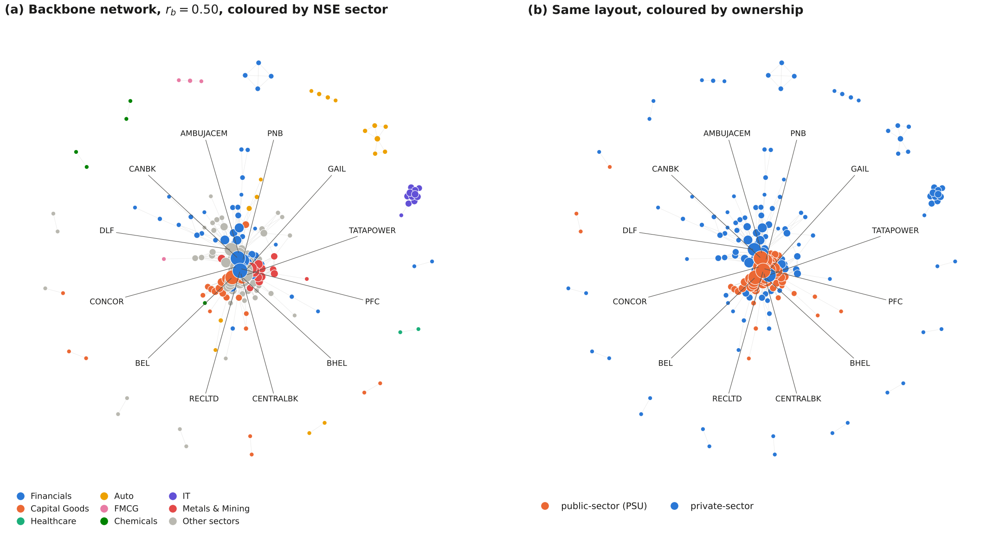

# Topological and structural analysis of the Indian stock market

A correlation-threshold network of Nifty 500 stocks built from three years of daily
returns (15 Nov 2023 – 13 Nov 2026), analysed with standard network-science tools and
explicit null models.

Course assignment for **ECS414/614 Network Science Theory and Applications**
(2026-27-I term, IISER Bhopal). The full write-up is in [`report/report.pdf`](report/report.pdf).



## What is in here

| Question | Script | Main outputs |
|---|---|---|
| Data, cleaning, correlations | `scripts/02_build_network.py` | data-quality audit, correlation overview, graph files |
| **A** Degree distribution | `scripts/03_degree_distribution.py` | linear / log-log plots, power-law test (Clauset–Shalizi–Newman) |
| **B** Top-10 centralities | `scripts/04_centrality.py` | degree, betweenness, eigenvector leaderboards; heavyweight check |
| **C** Clustering and sector homophily | `scripts/05_clustering_homophily.py` | clustering vs. random graphs, sector mixing, triangle census |
| **D** Threshold sensitivity | `scripts/06_threshold_sensitivity.py` | edges, path length, giant component for 81 thresholds |
| E1 The market mode | `scripts/07_market_mode.py` | single-index prediction of the network; market-neutral network |
| E2 Reliability | `scripts/08_stability.py` | block bootstrap, split halves, turbulent days, rolling windows |
| Report assets | `scripts/09_export_report_assets.py` | LaTeX macros and table bodies read by the report |

## Headline results

* **One market mode dominates.** The mean pairwise correlation is 0.24 and the first
  eigenvector of the correlation matrix carries about a quarter of the variance.
  Thresholds of 0.7–0.8 leave fewer than fifty edges, so the analysis uses
  `r* = 0.40` (95th percentile of correlations) and a backbone at `r_b = 0.50` (99th).
* **A. Broad, but not scale-free.** A power-law tail is rejected at both thresholds;
  forms with an exponential cut-off fit better.
* **B. Hubs are not the index heavyweights.** Degree and eigenvector centrality pick
  domestic-cyclical and public-sector stocks; Reliance, TCS and HDFC Bank sit in the
  middle of the ranking. Betweenness picks the thin bridges, above all the chain that
  ties the IT cluster to the rest of the market.
* **C. Clustered and homophilous.** Transitivity is about ten times that of a random
  graph, although most of it follows from the degree sequence. Triangles are six times
  more likely to lie inside one sector than chance, and state ownership (PSU) is an even
  stronger grouping than sector.
* **D. Fragile in size, stable in shape.** The edge count falls about five-fold for
  every 0.1 added to the threshold; the giant component erodes gradually and falls below
  half the market near `r = 0.44`.
* **Extensions.** A single-index model reproduces the ranking of hubs; removing the
  market factor reveals clean sector clusters. One trading day (4 June 2024) accounts
  for about 30% of the edges at `r*`.

## Quick start

```bash
git clone <this repo> && cd nse-stock-network
pip install -r requirements.txt

python scripts/01_download_data.py   # only needed to refresh data/raw (uses the cache otherwise)
python scripts/run_all.py            # steps 02-09, about 6 minutes
python -m pytest -q                  # 20 unit tests on synthetic data

cd report && pdflatex report.tex && pdflatex report.tex
```

or simply `make analysis report test`.

The repository ships with the cached download in `data/raw/`, so `run_all.py`
reproduces every number in the report without contacting any server.

## Method in brief

1. **Universe and prices.** Nifty 500 constituents with NSE industry labels; daily
   *Adj Close* from Yahoo Finance via `yfinance`, cached locally with a provenance log.
2. **Cleaning.** Stocks need prices on at least 97% of trading days (recent listings are
   dropped, not padded); gaps of up to three days are forward-filled. 436 of 501 symbols
   remain, with 739 daily log returns each.
3. **Audit of extreme returns.** Every daily move beyond 20% is flagged and checked
   against unadjusted close and volume. Nine are mechanical price resets (unadjusted
   splits/bonuses and demerger ex-dates) and are masked; the rest are genuine and kept.
   See [`data/reference/return_audit.md`](data/reference/return_audit.md).
4. **Network.** Log returns `R_i(t) = ln[P_i(t)/P_i(t-1)]`, Pearson correlation
   `rho_ij`, edge `i–j` iff `rho_ij > r`. All stocks stay in the graph as nodes.
5. **Null models.** Erdős–Rényi graphs of equal density, degree-preserving rewiring,
   sector-label permutation, time-shuffled returns, and a moving-block bootstrap.

All parameters live in [`config.yaml`](config.yaml).

## Repository layout

```
config.yaml               all parameters (universe, window, thresholds, seeds)
src/nsenet/               the package
    data.py               constituent list + yfinance download with local cache
    preprocess.py         price cleaning, log returns
    pipeline.py           audit of extreme returns; one prepared data set for all scripts
    network.py            correlation matrix, threshold graph, market model
    metrics.py            degree, centrality, clustering, homophily, path statistics
    fits.py               discrete power-law / exponential / log-normal / cut-off MLE
    nulls.py              random-graph nulls, shuffles, bootstrap
    sensitivity.py        threshold sweep
    temporal.py           rolling windows, split-half comparison
    plotting.py           figure style
    synthetic.py          factor-model generator (tests only)
scripts/                  numbered, runnable steps (01 ... 09) and run_all.py
tests/                    unit tests (synthetic data with known structure)
data/raw/                 cached download (prices, volumes, constituents, log)
data/reference/           hand-compiled PSU list and the return-audit notes
results/figures/          figures (PDF and PNG)
results/tables/           every table behind the figures and the report (CSV)
results/numbers/          every scalar quoted in the report (JSON)
results/graphs/           the two baseline networks as GraphML and edge lists
report/                   LaTeX source and compiled PDF
```

## Reproducibility notes

* All random procedures use the seed in `config.yaml`.
* The report does not contain hand-typed results: scripts write scalars to
  `results/numbers/*.json`, step 09 converts them into LaTeX macros, and the text reads
  them from there.
* Yahoo Finance revises its history from time to time. A fresh download may differ
  slightly from the snapshot in `data/raw/`; in particular the list of masked returns
  in `config.yaml` is specific to this snapshot, and the audit table
  (`results/tables/data_extreme_return_audit.csv`) should be re-read after any refresh.
* If the NSE servers refuse the scripted download of the constituent list, open the
  link in a browser and save the CSV into `data/raw/`.

## Data and licence

Code: MIT licence. Price data are from Yahoo Finance and the constituent list from NSE
Indices; they are included for reproducibility of a course assignment and remain subject
to their providers' terms.

## References

1. C. K. Tse, J. Liu, F. C. M. Lau, "A network perspective of the stock market",
   *Journal of Empirical Finance* 17 (2010) 659–667.
2. H. E. Moghadam et al., "Complex networks analysis in Iran stock market: The
   application of centrality", *Physica A* 531 (2019) 121800.
3. A. Clauset, C. R. Shalizi, M. E. J. Newman, "Power-law distributions in empirical
   data", *SIAM Review* 51 (2009) 661–703.
